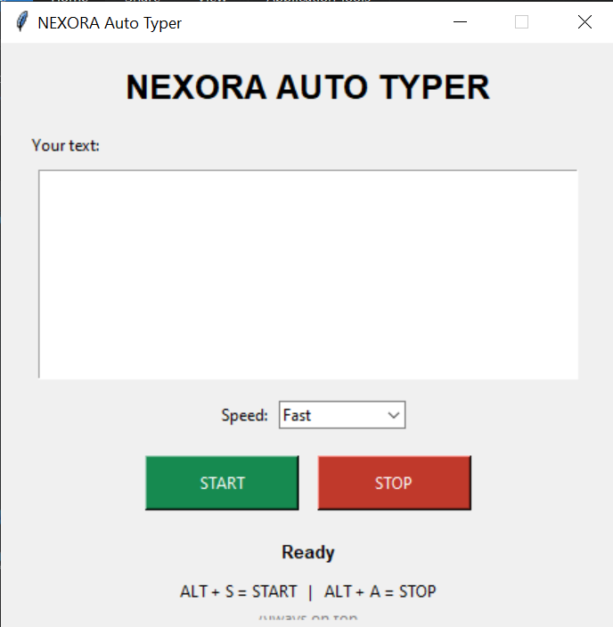

# NEXORA Auto Typer

A simple Python auto-typing application for Windows.

<div align="center">



# NEXORA Auto Typer

**A lightweight Python auto-typing tool for Windows.**

</div>
## Features

- Simple graphical interface
- Custom text input
- Adjustable typing speed
- Start and Stop controls
- Always-on-top window
- Keyboard shortcuts
- Continuous local preview

## Keyboard Shortcuts

| Key | Action |
|---|---|
| `Alt + S` | Start |
| `Alt + A` | Stop |

## Requirements

- Windows 10 / 11
- Python 3

## Installation

Clone this repository:

```bash
git clone https://github.com/zrong-me/Auto_Typer-
cd Auto_Typer
```

Install dependencies:

```bash
python -m pip install keyboard
```

Run:

```bash
python main.py
```

## Build EXE

Install PyInstaller:

```bash
python -m pip install pyinstaller
```

Build:

```bash
python -m PyInstaller --onefile --noconsole --name NEXORA-AutoTyper main.py
```

Your EXE will be in the `dist` folder.

## Project Structure

```text
NEXORA-AutoTyper/
├── main.py
└── README.md
```

## Responsible Use

Use this project for personal productivity and local testing. Do not use automation to spam people, flood chats, or send unwanted messages.

## Built With

- Python
- Tkinter
- Keyboard
- PyInstaller

## License

No license has been added yet.

---

**NEXORA Auto Typer**
